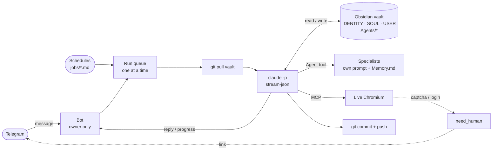
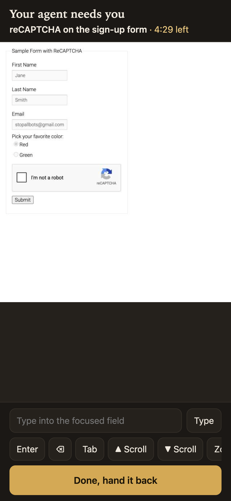
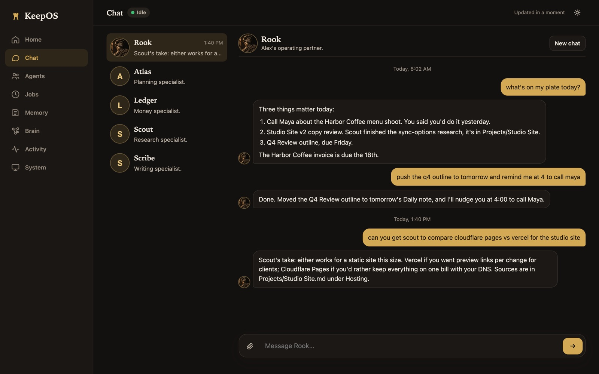
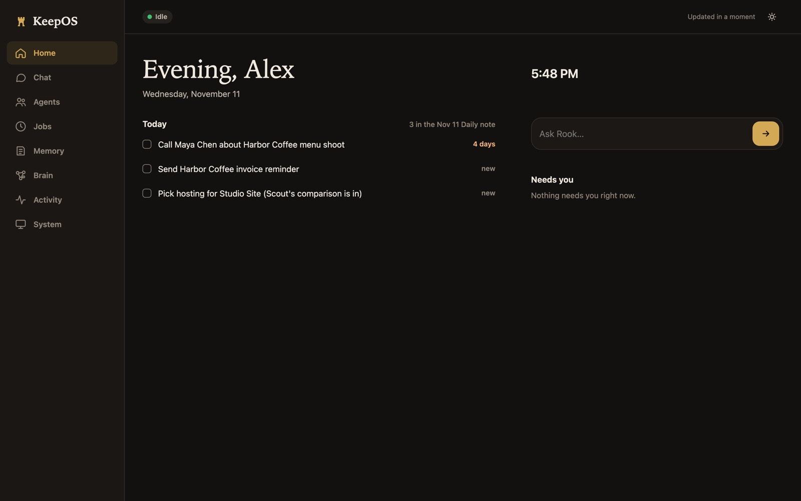
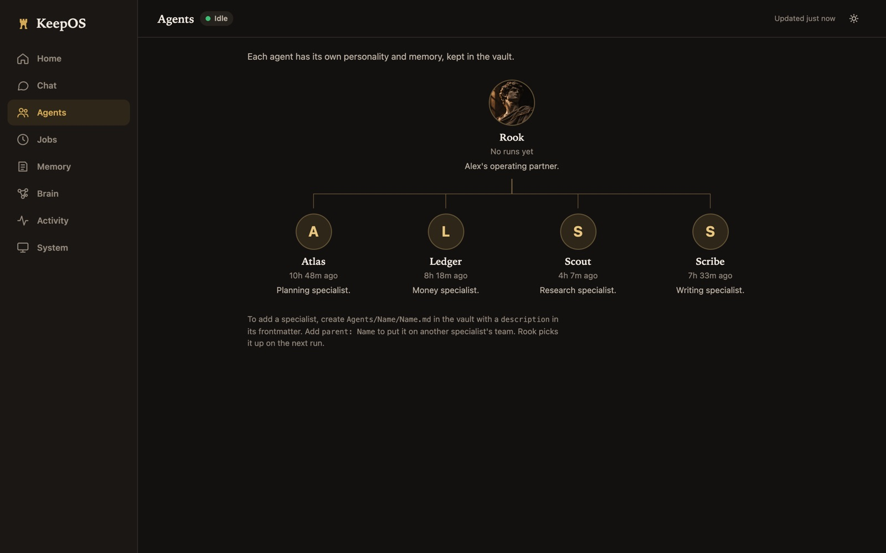
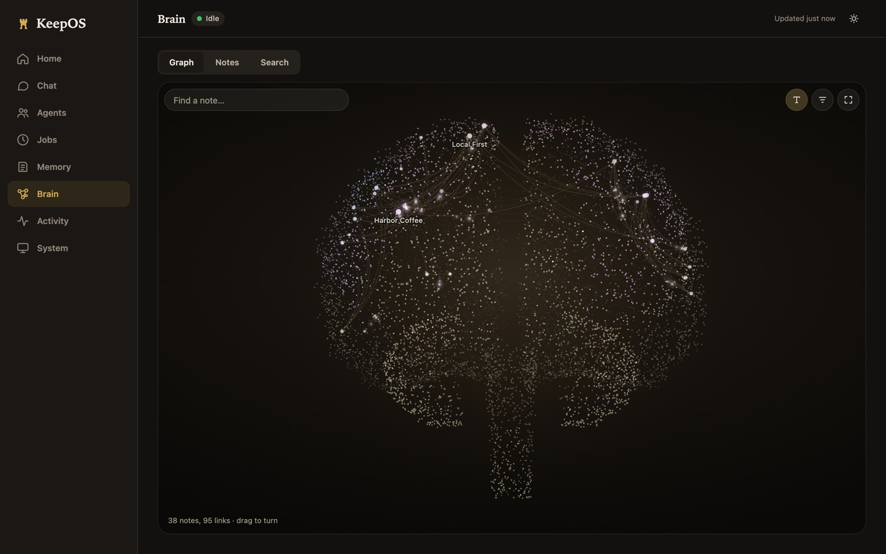

# KeepOS

[](https://github.com/edwardjones7/keepos/actions/workflows/ci.yml)

An always-on personal agent that lives in your notes.

KeepOS runs Claude Code headless inside an Obsidian vault, on your own machine, and you talk to it from Telegram. The vault is its memory: it reads your notes before it answers and writes to them before it finishes, so everything it knows is a markdown file you can open, read and fix. It messages you on a schedule, hands work to specialist agents that keep their own memory, and, when a website wants a human, sends you a link to take over its browser from your phone.

> **This is an open-source version, so not everything is in here.** Rook is the main agent I run every day on my own server, and KeepOS is everything packaged around it: the runtime, memory, specialists, jobs, browser and graph. This repo is the core that the full system is built on, without my personal data and private integrations, and you can run it yourself. What the full version adds is listed under [The full version](#the-full-version). How Rook works and what it does day to day is in **[the write-up on the Elenos blog](https://elenos.ai/blog/rook-personal-ai-agent/)**.

It's two parts:

| Folder | What |
| --- | --- |
| [`agent/`](agent/) | The agent: Telegram bot, headless Claude Code runner, conversations that file themselves into the vault, scheduled jobs, specialist agents and the live browser handoff. |
| [`brain-graph/`](brain-graph/) | Turn any Obsidian vault into a living 3D brain. Zero dependencies. |


## How it works



Every message and every scheduled job becomes one headless Claude Code run inside the vault. The service pulls the vault first, streams the run's tool calls to Telegram as live status lines ("reading Projects/Trip.md"), and commits whatever the run wrote. Runs go through a single queue, because every run touches the same files and the same git repo.

A real run against the example vault, from the terminal (`npm run ask`). The status lines are what Telegram shows while it works. Rook hands off to its Scout specialist, and Scout's steps are labelled as Scout's:

```text
$ npm run ask -- "Ask Scout, in one line, what the example project's next step is according to the vault."
  · handing to Scout: Find example project's next step
  · Scout: searching the vault for "example"
  · Scout: looking for **/*.md
  · Scout: reading Projects/Example Project.md
  · Scout: running ls
  · Scout: updating Agents/Scout/Memory.md
Scout says the example project's next step is "replace this vault with your own (set VAULT_DIR)," per Projects/Example Project.md.
```

And the handoff: the agent hit a reCAPTCHA (Google's public demo page), and this is the `/live` page the Telegram link opens, showing its real tab. Tap the box, press Done, and it carries on.

<p align="center"></p>

## The full version

The private version I run is about 18,000 lines on the same core: 10 specialists, 9 custom MCP tool servers, 16 scheduled jobs and 99 tests. None of the following is in this repo:

- **Job search.** A specialist that scans new-grad job boards and company career pages every day, ranks postings against my résumé, writes a tailored application packet for strong fits, and submits an application only after I approve that exact posting. Captchas and logins come to my phone through the live browser handoff, which *is* in this repo.
- **Email, calendar and school.** My mailboxes over IMAP: it reads and drafts, and an email goes out only after I tap Send in Telegram or the dashboard. My calendar and coursework from Canvas and a homework platform, read-only.
- **Money.** My investment portfolio through SnapTrade, read-only, plus market news.
- **Content.** A pipeline that plans posts, renders carousel slides and publishes to Instagram, only after I approve each card.
- **Lead research.** Finds and qualifies businesses from free public sources, for sales outreach.
- **Triggers and follow-ups.** It reacts to new email and calendar events, and follows up on things I said I'd do.
- **Voice.** Talk to it from a Siri shortcut or a Telegram voice note, and it answers out loud.
- **It edits its own code.** From Telegram, Rook can change its own codebase in a separate git worktree, typecheck it, and ship it to the server after a PIN.
- **The dashboard.** An installable web app: one chat shared with Telegram, the day's tasks, each specialist's workspace, the job pipeline, the vault as a brain, activity and system health.

These are screenshots of that dashboard, run against a sample vault with made-up data.

<p align="center"></p>

| | |
| --- | --- |
|  |  |
| **Home.** Today's open tasks, read from the Daily note. | **Agents.** The specialist team, each with its own memory. |
|  | |
| **Brain.** The vault as a graph ([`brain-graph/`](brain-graph/)). | |

## Design decisions

**Claude Code is the runtime.** There's no agent framework here. `claude -p --output-format stream-json` already has the loop, the tools, subagents, MCP and permission modes, and it runs on a Claude subscription instead of per-token API billing. The service around it is under 2,000 lines, the /live page included: process management, memory, scheduling and a phone interface.

**The vault is the memory, not the chat log.** A conversation is a resumed Claude session while it's active. After a few idle hours it gets one last "wrap-up" turn that files every durable fact, decision and commitment into the right note, then it's retired. The next conversation starts small and reads what it needs. There's no vector database: the agent searches the notes with Grep and Glob, like you would.

**Personality is a file, read fresh every run.** `IDENTITY.md`, `SOUL.md` and `USER.md` are injected as the system prompt on every run, so editing one in Obsidian changes the next reply, and the core instructions never get buried under a long conversation. Anything that changes between runs (the time, recent notes) goes in the message instead, so the system prompt stays byte-identical and the prompt cache holds.

**Specialists are notes too.** `Agents/<Name>/<Name>.md` defines a specialist: a description that tells the main agent when to hand off, a model, an optional tool allowlist, and a personality. Each keeps its own `Memory.md`, which it's instructed to update before every run ends. Teams nest (`parent: Lead`), and an agent that reads untrusted web pages can be cut off from the vault entirely (`vault: false`).

**Proactive, but quiet.** Jobs are markdown files with a cron schedule. A job that finds nothing worth your attention answers `NOTHING_TO_SEND` and no message goes out. That rule is what keeps a proactive agent from turning into noise.

**Humans for what humans are for.** When the browser hits a captcha, a login or a verification code, the agent doesn't try to get around it. It calls `need_human`, you get a Telegram link, and the page shows its live tab (a DevTools screencast) that you drive with taps and typing. You press Done and it carries on. Logins persist in the browser profile, so it asks once per site.

**One owner, least privilege.** The bot answers one Telegram user and ignores everyone else. The default permission mode lets the agent write notes but limits the shell to read-only commands. The `/live` page needs a random secret from the link and should be bound to a private address such as a Tailscale IP.

## Security

The `/live` page shows a browser that may be logged in to sites, and anyone who can open it can drive that browser. So:

- **Bind it privately.** Set `WEB_HOST` to a Tailscale IP (reachable only from your own devices) or to `127.0.0.1` and use an SSH tunnel. Never bind it to a public address. It's off unless `BROWSER_LIVE=true`.
- **Every request needs the link's secret.** It's random, kept in `data/live-token`, and compared in constant time. The page drops it from the address bar and sends no referrer. Delete the file and restart to rotate it.
- **What's stored, all under `agent/data/` (gitignored):** the browser profile with its cookies and logins (`browser-profile/`), the `/live` secret, Claude session ids for active conversations, and the current handoff. Your bot token lives in `.env`, also gitignored. Your notes stay in your vault.
- **Never sign in to email or banking in the agent's browser.** A page it opens can act with any session the profile holds.
- The Telegram bot answers one user id and ignores everyone else. The default permission mode lets the agent write notes but limits the shell to read-only commands.

More in [`agent/README.md`](agent/README.md#security).

## Tests

`npm test` in `agent/` (the queue, quiet-job detection, usage-limit handling, specialist loading, message splitting, status lines) and in `brain-graph/`. CI runs both, plus a typecheck, on every push.

## Get started

```bash
git clone https://github.com/edwardjones7/keepos.git
cd keepos/agent
npm install
cp .env.example .env   # add your Telegram bot token and user id
npm run ask -- "what's in this vault?"   # one turn from the terminal, against the example vault
npm start              # the bot, schedules and all
```

You need Node 22+ and [Claude Code](https://docs.claude.com/en/docs/claude-code) installed and logged in. The full setup is in [`agent/README.md`](agent/README.md).

## License

MIT.

Built by [Edward Jones](https://github.com/edwardjones7) · [Elenos](https://elenos.ai) · [The Rook write-up](https://elenos.ai/blog/rook-personal-ai-agent/).
