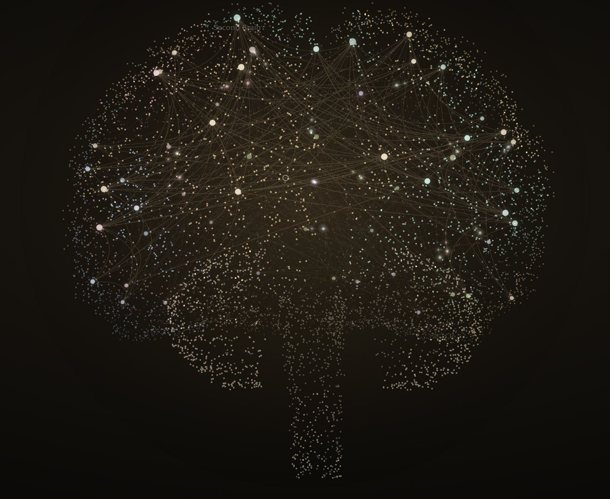

# brain-graph

Turn any Obsidian vault into a living 3D brain.



Your notes become glowing nodes. Your links become arcs through the white matter. Signals travel along the links, and the notes they reach flare. Drag to turn it, scroll to zoom, click a note to send a ripple through its neighbours.

This is the graph from [KeepOS](https://elenos.ai/blog/rook-personal-ai-agent/), the personal agent system I'm building. I got asked for the theme enough times that I pulled it out.

## Run it

You need Node 20 or newer. Nothing else: no dependencies, no build step, no account.

```bash
git clone https://github.com/edwardjones7/brain-graph.git
cd brain-graph
node bin/brain-graph.mjs "/path/to/your/vault"
```

No vault yet? Try the sample:

```bash
npm run demo
```

## Options

| Flag | What it does |
| --- | --- |
| `--out brain.html` | Writes one standalone HTML file instead of starting a server |
| `--anonymous` | Strips every note and folder name |
| `--port 4173` | Sets the local port |
| `--no-open` | Doesn't open the browser |

## Sharing yours

A normal export contains your note names. Before you post one anywhere, use `--anonymous`:

```bash
node bin/brain-graph.mjs "/path/to/your/vault" --anonymous --out brain.html
```

That keeps the shape, the links and the colours, and drops the names.

Your notes stay on your machine. The tool scans your notes for links and keeps only file names and links, and the server only listens on localhost.

## What you get

- **Your Obsidian colours.** Simple `path:` colour groups in `.obsidian/graph.json` carry over. Without them, each top-level folder gets its own colour.
- **Obsidian's link rules.** Wikilinks, aliases, frontmatter links and unresolved links all work.
- **Search, filters and a local graph.** Find a note, hide groups, or focus on one note's neighbourhood.
- **Open in Obsidian.** Double-click a note, or press Open on its card.

## How it works

A force layout decides which notes sit together. That flat map then gets folded over a cortex, so linked notes stay neighbours on the surface while the whole thing reads as an organ instead of a hairball.

The fine dust is decoration. It's a fixed cloud that gives the brain its shape however few notes you have, tinted by the nearest note's group. It's all plain canvas, in `web/graph.js`.

## License

MIT. Use it, change it, ship it.

Built by [Elenos](https://elenos.ai).
